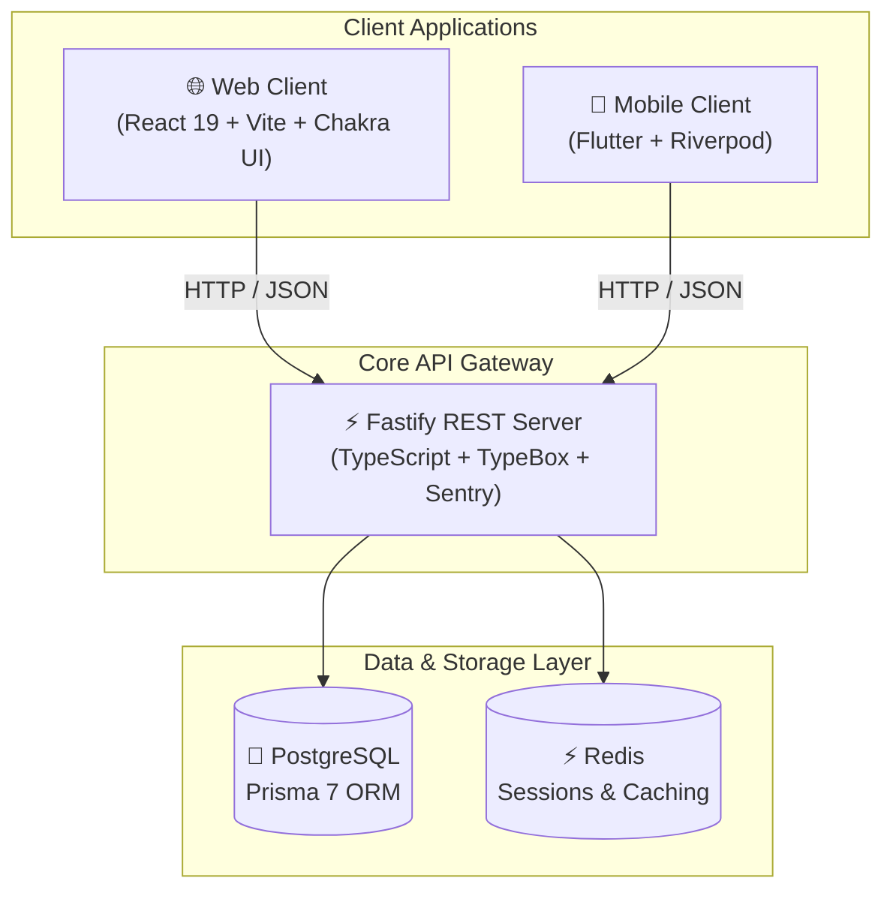

# 🎓 TeachMeter

**Empowering students, educators, and academic institutions through transparent, structured, and constructive evaluations.**

---

## 🌟 About TeachMeter

TeachMeter is a full-stack social platform that enables students to constructively rate, review, and evaluate academic instructors, faculty, deans, and educational institutions (universities, colleges, and schools). 

Designed with enterprise-grade modular architecture, TeachMeter provides seamless experiences across web and mobile platforms with real-time sync, strict validation, and multi-layered profanity filtering.

---

## 🏛️ System Architecture

---

## 📦 Repositories

| Repository | Description | Primary Stack | Status |
| :--- | :--- | :--- | :---: |
| **[`teachmeter-server`](https://github.com/Teach-Meter/teachmeter-server)** | High-performance backend REST API, validation engine, and auth service. | Fastify, TypeScript, Prisma, Redis | Active |
| **[`teachmeter-web`](https://github.com/Teach-Meter/teachmeter-web)** | Modern, accessible web application and administrative dashboard. | React 19, Vite, TanStack, Chakra UI | Active |
| **[`teachmeter-mobile`](https://github.com/Teach-Meter/teachmeter-mobile)** | Native cross-platform mobile client for iOS and Android. | Flutter, Dart, Riverpod, Dio | Active |

---

## 🚀 Key Features

- **Multi-Factor Evaluations**: Rate instructors across clarity, grading fairness, helpfulness, and course workload.
- **Institutional Benchmarking**: Explore institutions and departments with aggregated sentiment metrics.
- **Automated Moderation**: Content moderation with English and multilingual profanity filtering.
- **Secure Authentication**: Strict JWT authentication with token rotation and Redis session management.
- **Progressive Standards**: Unified Agent Skills configured across all projects for streamlined continuous development.

---

Maintained with ❤️ by the <a href="https://github.com/Teach-Meter">TeachMeter</a> Team.

